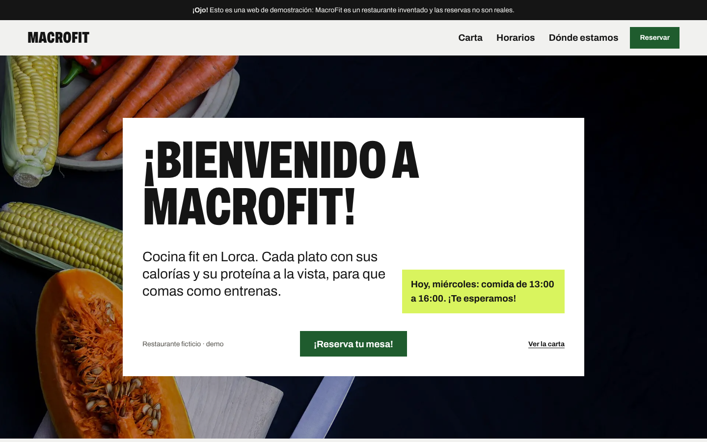
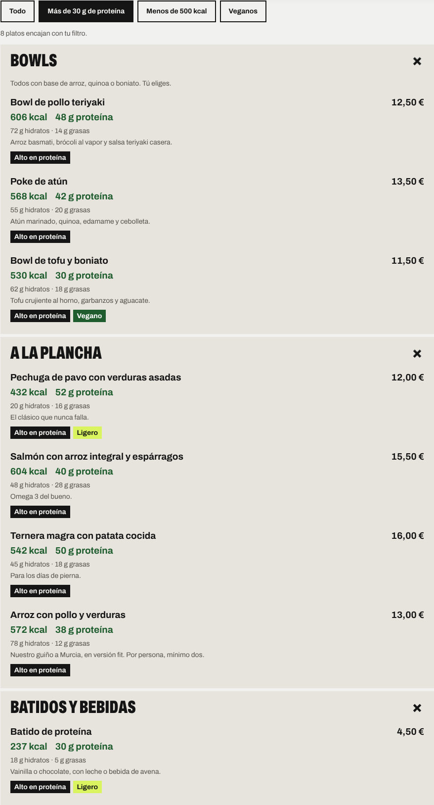
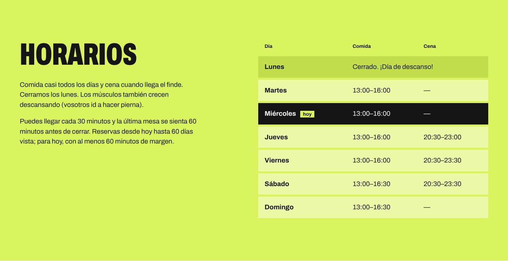
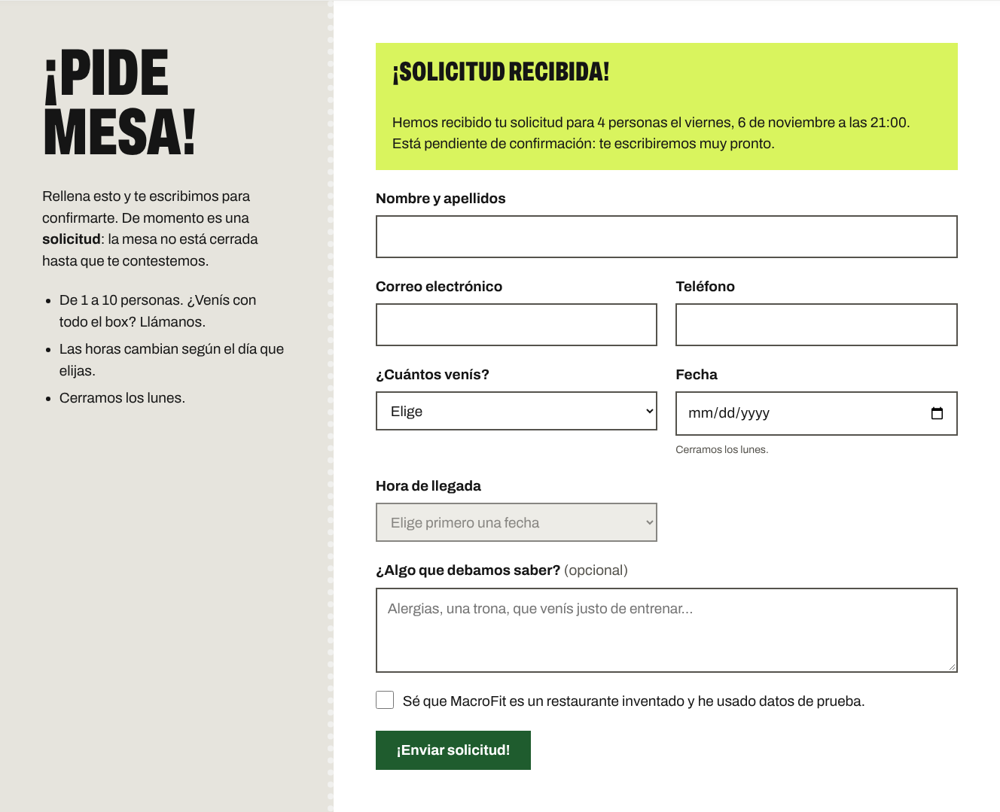
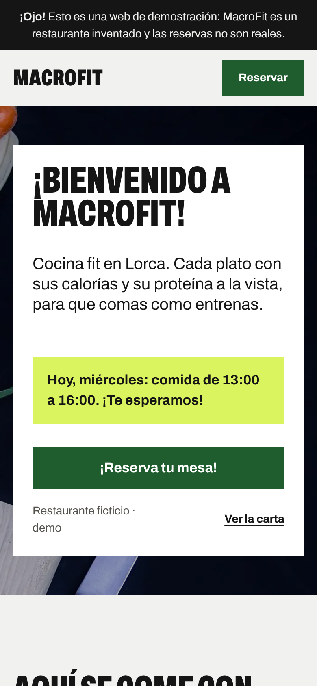

# MacroFit · web de restaurante fit con reservas

> **Proyecto de demostración.** MacroFit es un restaurante **ficticio** de Lorca: el nombre, la dirección, la carta, los precios y los valores nutricionales son inventados y las reservas no son reales.

Web de un restaurante fit pensado para gente que entrena y quiere saber lo que come: **cada plato muestra sus calorías, proteínas, hidratos y grasas**, la carta se puede filtrar (alto en proteína, menos de 500 kcal, veganos) y hay un **sistema de solicitud de reservas** en PHP y MySQL que respeta los horarios del local.



## Qué problema resuelve

Muchas webs de restaurante muestran un horario en una sección y aceptan reservas a cualquier hora en otra. En este proyecto los horarios están en **un único archivo de configuración** que se usa para:

1. pintar la tabla de horarios de la web,
2. ofrecer en el formulario solo las horas válidas del día elegido,
3. validar la reserva en el servidor.

Si cambias un horario, cambia en toda la aplicación y no puede haber incoherencias.

## Funcionalidades

- Carta con **calorías y proteína bajo el nombre de cada plato** (más hidratos y grasas). Las calorías se calculan a partir de los macros (4/4/9 kcal por gramo), así nunca se contradicen.
- **Filtros fit**: más de 30 g de proteína, menos de 500 kcal y veganos. Sin JavaScript se ve la carta completa.
- Menú superior fijo al hacer scroll y botón para volver arriba al llegar al final.
- Horarios por día con servicio de comida y/o cena; los días sin servicio se muestran como cerrados.
- Formulario de reserva:
  - las horas disponibles se adaptan al día elegido (cada 30 min, última reserva 1 h antes del cierre);
  - no permite fechas pasadas, días de cierre ni horas fuera de servicio; para hoy, exige 1 h de margen;
  - valida nombre, correo, teléfono, comensales (1–10) y comentarios;
  - **toda la validación se repite en el servidor**; el formulario funciona incluso sin JavaScript;
  - errores junto a cada campo y resumen accesible; mensaje claro al terminar.
- Las solicitudes se guardan en MySQL/MariaDB con estado `pendiente`: la web dice "solicitud recibida", nunca "reserva confirmada".
- Diseño responsive (móvil, tablet y escritorio) y respeto a `prefers-reduced-motion`.

| Carta filtrada por proteína | Horarios desde la configuración |
| --- | --- |
|  |  |

| Solicitud registrada | Móvil |
| --- | --- |
|  |  |

## Tecnologías

- **PHP 8.1+** sin frameworks (PDO para la base de datos).
- **MySQL 8 / MariaDB 10.4+**.
- **HTML5, CSS3 y JavaScript** sin librerías.
- Tipografía **Archivo** de Google Fonts, descargada y alojada en el propio proyecto (los visitantes no hacen peticiones a Google, mejor para el RGPD).
- Fotos de dominio público (CC0) de Wikimedia Commons y un plano dibujado en SVG.

## Seguridad

- Consultas preparadas con PDO (sin concatenar datos del usuario en el SQL).
- Validación completa en el servidor; la del navegador solo ayuda al usuario.
- Escape de todo lo que se muestra en HTML (`htmlspecialchars`) para evitar XSS.
- Token CSRF en el formulario y cookie de sesión `HttpOnly` + `SameSite=Lax`.
- Campo trampa (*honeypot*) contra bots.
- Cabeceras `Content-Security-Policy`, `X-Content-Type-Options` y `Referrer-Policy`.
- Errores técnicos solo en el log del servidor; el visitante ve un mensaje genérico.
- Credenciales fuera del código (`config/config.php`, ignorado por Git) y usuario de base de datos con permisos mínimos (`SELECT`, `INSERT`).
- Casilla obligatoria que recuerda que es una demo y que hay que usar datos inventados.

## Estructura

```
├── public/              ← única carpeta accesible desde el navegador
│   ├── index.php        ← portada: prepara los datos y carga la plantilla
│   ├── reservar.php     ← recibe el formulario (POST), valida, guarda y redirige
│   └── assets/          ← css, js, imágenes y fuentes
├── src/                 ← lógica en PHP
│   ├── Horario.php           ← días de apertura y horas reservables
│   ├── ValidadorReserva.php  ← reglas de validación
│   ├── ReservaRepository.php ← SQL de la tabla reservas
│   ├── Database.php          ← conexión PDO
│   ├── Csrf.php              ← token anti-CSRF
│   ├── helpers.php           ← escape HTML, precios, calorías, etiquetas, mensajes flash
│   └── bootstrap.php         ← arranque común (config, sesión, cabeceras)
├── config/
│   ├── horarios.php          ← ÚNICA fuente de los horarios y reglas de reserva
│   ├── carta.php             ← platos, precios y macros
│   └── config.example.php    ← plantilla de credenciales (copiar a config.php)
├── templates/inicio.php ← HTML de la página
├── database/schema.sql  ← base de datos, tabla y usuario
└── tests/run.php        ← pruebas automáticas
```

## Requisitos

- PHP 8.1 o superior con las extensiones `pdo_mysql` y `mbstring` (vienen activadas en XAMPP).
- MySQL 8.0.16+ o MariaDB 10.4+.
- En Windows, lo más sencillo es [XAMPP](https://www.apachefriends.org/es/), que incluye ambos.

## Instalación y ejecución local

1. **Clona el repositorio**

   ```bash
   git clone https://github.com/TU_USUARIO/macrofit.git
   cd macrofit
   ```

2. **Crea la base de datos.** Arranca MySQL desde el panel de XAMPP. Abre `database/schema.sql`, cambia `CAMBIA_ESTA_CONTRASENA` por una contraseña tuya e impórtalo en phpMyAdmin (pestaña *Importar*) o desde la terminal:

   ```bash
   mysql -u root -p < database/schema.sql
   ```

   (En PowerShell el símbolo `<` no funciona: usa `cmd /c "mysql -u root -p < database\schema.sql"` o phpMyAdmin.)

3. **Configura la conexión.** Copia la plantilla y pon la misma contraseña:

   ```bash
   cp config/config.example.php config/config.php
   ```

4. **Arranca la web** con el servidor que trae PHP, usando `public` como raíz:

   ```bash
   php -S localhost:8000 -t public
   ```

   Abre <http://localhost:8000>. En Windows con XAMPP, si `php` no se reconoce, usa `C:\xampp\php\php.exe -S localhost:8000 -t public`.

   > **Con Apache de XAMPP** puedes servirla en `http://localhost/macrofit` añadiendo esto a `C:\xampp\apache\conf\httpd.conf` (cambia la ruta por la tuya) y reiniciando Apache:
   >
   > ```apache
   > Alias /macrofit "C:/ruta/al/proyecto/public"
   > <Directory "C:/ruta/al/proyecto/public">
   >     Options -Indexes +FollowSymLinks
   >     AllowOverride None
   >     Require local
   > </Directory>
   > ```
   >
   > Las carpetas internas incluyen un `.htaccess` que bloquea el acceso directo por si se publica el proyecto entero.

5. **Consulta las solicitudes guardadas** (phpMyAdmin o terminal):

   ```sql
   SELECT id, nombre, comensales, fecha, hora, estado, creada_en FROM macrofit.reservas ORDER BY creada_en DESC;
   ```

## Pruebas

```bash
php tests/run.php
```

57 pruebas sin dependencias externas: horarios (días cerrados, horas por servicio, margen para hoy, límite de 60 días), todas las reglas del validador, el repositorio (con SQLite en memoria, incluido un intento de inyección SQL), el token CSRF y el cálculo de calorías y etiquetas de la carta. Usan una fecha "actual" fija, así que dan el mismo resultado cualquier día.

## Cambiar los horarios

Edita solo `config/horarios.php`. Por ejemplo, para abrir los lunes a mediodía:

```php
1 => [
    ['nombre' => 'Comida', 'apertura' => '13:00', 'cierre' => '16:00'],
],
```

La tabla de la web, los textos de días de cierre, el formulario y la validación del servidor se actualizan solos.

## Mejoras futuras

- **V1.1**: días festivos o de vacaciones cerrados por fecha; borrado automático de solicitudes antiguas en la demo pública.
- **V1.2**: panel privado con inicio de sesión para confirmar o cancelar solicitudes; aforo máximo por franja; filtro por alérgenos.
- **V2.0**: aviso por correo al confirmar; carta gestionada desde la base de datos.

## Créditos

- Tipografía: [Archivo](https://fonts.google.com/specimen/Archivo), SIL Open Font License (ver `public/assets/fonts/LICENCIA-OFL-Archivo.txt`).
- Fotos de Wikimedia Commons, todas con licencia CC0 (dominio público). Son ilustrativas: no muestran platos reales del restaurante.
  - Verduras (portada): *Preparing food (Unsplash)*, NordWood Themes.
  - Bowl de atún: *Poke bowl 001*, Arnaud 25.
  - Salmón con espárragos: *Grilled salmon and asparagus on rice - Boston, Massachusetts*, Daderot.
  - Bowl de tofu: *Fried Tofu Poke Bowl (S) with kimchi sauce - Kitokito*, Andy Li.
  - Tostadas de aguacate: *Smashed avocado & poached eggs - M&S Café 2023-12-28*, Andy Li.
  - Tortitas: *Pancakes with Berries (Unsplash)*, Herson Rodriguez.
  - Batido de kiwi: *Kiwi Smoothie*, rawpixel.com.
- Plano de la zona: dibujo SVG propio e inventado.

Proyecto personal de portfolio desarrollado durante el ciclo de Desarrollo de Aplicaciones Web (DAW).
